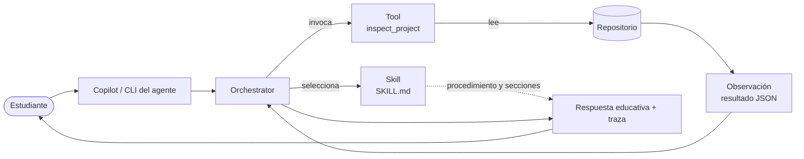

# Engineering Copilot Agent

> [English version](README.md)

Un proyecto pequeño y amigable que muestra **cómo funciona un agente de IA** por dentro.
Clónalo, ábrelo en VS Code y ejecútalo. Sin API keys, sin nube, sin base de datos:
solo Python y los archivos de este repositorio.

> Los modelos aportan inteligencia. Los agentes coordinan decisiones y acciones.
> Las skills aportan procedimientos reutilizables. Las tools aportan capacidades.

---

## 1. Descripción del proyecto

El **Engineering Copilot Agent** ayuda a los estudiantes a:

- inspeccionar la estructura de un proyecto,
- leer archivos permitidos del repositorio,
- explicar código a nivel principiante, intermedio o avanzado,
- realizar una revisión básica de código (correctitud, legibilidad, pruebas, seguridad),
- ver exactamente cómo una petición se convierte en *selección de skill -> llamada a tool -> observación -> respuesta*.

El agente es **determinístico**: en lugar de un modelo de lenguaje grande, usa
reglas pequeñas y legibles. Así puedes ver cada decisión que toma. Agentes reales
como GitHub Copilot en modo agente usan la misma arquitectura; allí las
decisiones las toma un modelo.

## 2. Objetivos de aprendizaje

Al terminar esta sesión deberías poder:

1. Explicar qué es un agente.
2. Distinguir entre **modelo**, **agente**, **tool** y **skill**.
3. Describir cómo un agente **observa** su entorno a través de tools.
4. Explicar cómo una tool permite que un agente **actúe** de forma segura.
5. Explicar cómo una skill le da al agente un **procedimiento reutilizable**.
6. Extender el agente con una nueva skill y una nueva tool.
7. Usar GitHub Copilot en VS Code para trabajar con el proyecto.

## 3. Arquitectura



Ciclo de vida de una petición:

```text
Petición del usuario
    -> Orchestrator del agente
    -> Seleccionar skill
    -> Seleccionar e invocar tool
    -> Observar el resultado estructurado
    -> Aplicar el procedimiento de la skill
    -> Producir una respuesta educativa
```

Más detalle (en inglés): [docs/architecture.md](docs/architecture.md) y
[docs/diagrams.md](docs/diagrams.md).

## 4. Requisitos previos

- Python **3.11 o superior** (`python --version`).
- Git.
- VS Code (recomendado) con la extensión de Python y GitHub Copilot.

## 5. Inicio rápido

```bash
git clone <repository-url>
cd engineering-copilot-agent
python -m venv .venv
```

Sustituye `<repository-url>` por la URL real de este repositorio.

Activa el entorno virtual:

- Windows PowerShell:

  ```powershell
  .venv\Scripts\Activate.ps1
  ```

- Linux/macOS:

  ```bash
  source .venv/bin/activate
  ```

## 6. Instalación

```bash
pip install -e ".[dev]"
pytest
ruff check .
```

`-e` instala el proyecto en modo *editable*: tus cambios se aplican de
inmediato y el comando `engineering-agent` puede encontrar la carpeta `skills/`.

## 7. Comandos del demo

Ejecútalos desde la raíz del repositorio:

```bash
engineering-agent inspect sample_project
engineering-agent explain sample_project/calculator.py --level beginner
engineering-agent review sample_project/calculator.py
engineering-agent skills
engineering-agent tools
```

Más opciones:

```bash
engineering-agent info sample_project/calculator.py
engineering-agent explain sample_project/calculator.py --level advanced
engineering-agent review sample_project
engineering-agent ask "find potential issues in sample_project/calculator.py"
engineering-agent review sample_project/calculator.py --json
```

Sin instalar el comando también puedes usar `python -m agent.cli <comando>`.

> Nota: las reglas de intención y las respuestas del agente están en inglés.
> Con `ask`, escribe la petición en inglés (por ejemplo `"explain ..."` o `"review ..."`).

Códigos de salida: `0` éxito, `1` fallo controlado (ruta inválida, petición no
reconocida), `2` error de uso (argumentos inválidos).

## 8. Estructura del repositorio

```text
engineering-copilot-agent/
|-- .github/
|   |-- copilot-instructions.md     # Cómo debe comportarse Copilot en este repo
|   |-- instructions/               # Instrucciones por tipo de archivo
|   `-- prompts/                    # Prompt files reutilizables para Copilot
|-- agent/
|   |-- instructions.md             # Reglas de operación del agente
|   |-- models.py                   # Contratos de datos (ToolSpec, Skill, AgentResponse...)
|   |-- tool_registry.py            # Registrar, listar e invocar tools
|   |-- skill_loader.py             # Descubrir y leer archivos SKILL.md
|   |-- orchestrator.py             # El ciclo del agente y las reglas de intención
|   |-- code_analysis.py            # Hechos y revisiones basados en ast
|   |-- responses.py                # Convierte observaciones en respuestas Markdown
|   `-- cli.py                      # Interfaz de línea de comandos
|-- tools/
|   `-- inspect_project.py          # Tool de solo lectura: tree, read_file, file_info
|-- skills/
|   |-- explain-code/SKILL.md       # Procedimiento para explicar código
|   `-- code-review/SKILL.md        # Procedimiento para revisar código
|-- sample_project/                 # Una pequeña calculadora para explorar
|-- tests/                          # Pruebas con pytest
|-- examples/                       # Recorridos paso a paso
`-- docs/                           # Arquitectura, diagramas, guion del demo, laboratorio
```

## 9. Agentes, tools y skills

| Concepto | Qué es | En este repositorio |
|---|---|---|
| **Modelo** | Aporta inteligencia: entiende lenguaje y genera respuestas. | Sustituido por reglas transparentes para que veas cada decisión. En Copilot, es el LLM. |
| **Agente** | Coordina decisiones y acciones en un ciclo: decidir, actuar, observar, responder. | `agent/orchestrator.py` |
| **Tool** | Una *capacidad*: código que hace algo en el entorno y devuelve datos estructurados. | `tools/inspect_project.py` (`tree`, `read_file`, `file_info`) |
| **Skill** | Un *procedimiento*: instrucciones en Markdown que indican cómo abordar una tarea y dar forma a la respuesta. No ejecuta nada por sí misma. | `skills/explain-code/SKILL.md`, `skills/code-review/SKILL.md` |
| **Entorno** | Lo que el agente observa. | Este repositorio |

Una forma útil de recordarlo: una **tool** es una *mano* (puede tocar cosas), una
**skill** es una *receta* (dice qué hacer y en qué orden) y el **agente** es el
*cocinero* que decide qué receta seguir y qué mano usar.

## 10. Ejemplo de interacción

```text
$ engineering-agent explain sample_project/calculator.py --level beginner
Engineering Copilot Agent
=========================
Request        : explain sample_project/calculator.py
Selected skill : explain-code
Selected tool  : inspect_project.read_file
Tool arguments : {"operation": "read_file", "path": "sample_project/calculator.py"}
Why            : The request asks for an explanation, so the explain-code skill was selected. ...

Trace
-----
 1. Received request.
 2. Classified intent as code explanation.
 3. Selected explain-code skill.
 4. Loaded instructions from skills/explain-code/SKILL.md.
 5. Selected inspect_project.read_file.
 6. Validated requested path.
 7. Read file successfully.
 8. Parsed the source with ast (the code was not executed).
 9. Applied the explain-code response structure (7 sections, beginner level).
10. Produced educational response.

Response
--------
# Explanation of `sample_project/calculator.py`
## Purpose
...
```

Agrega `--json` para ver la respuesta estructurada completa (`request`,
`selected_skill`, `selected_tool`, `tool_arguments`, `observation`,
`reasoning_summary`, `educational_response`, `trace`).

## 11. Límites de seguridad

- La tool es de **solo lectura**. Nunca escribe, mueve ni borra archivos.
- Las rutas deben permanecer **dentro de la raíz del workspace**. Se rechazan
  trucos con `../` y rutas absolutas fuera de la raíz.
- Los archivos sensibles (`.env`, claves privadas, credenciales) **nunca se leen**.
- El código inspeccionado **nunca se ejecuta**. Python se analiza con `ast`.
- Sin comandos de shell, sin red, sin API keys.

Pruébalo:

```bash
engineering-agent explain ../README.md      # PATH_OUTSIDE_ROOT
engineering-agent explain .env              # SENSITIVE_FILE (si el archivo existe) o NOT_FOUND
```

Consulta [SECURITY.md](SECURITY.md).

## 12. Cómo crear una nueva skill

1. Crea `skills/<tu-skill>/SKILL.md` (letras minúsculas, dígitos y guiones).
2. Empieza el archivo con front matter:

   ```markdown
   ---
   name: tu-skill
   description: Una frase que indique cuándo usar esta skill.
   ---
   ```

3. Escribe el **procedimiento** como pasos numerados y las **reglas** a seguir.
4. Agrega una lista `## Response Sections` con las secciones de la respuesta.
5. Ejecuta `engineering-agent skills` para verla y `pytest` para validar.
6. Para que la CLI la use, agrega un `IntentRule` en `agent/orchestrator.py`.

Recorrido completo (en inglés): [examples/04-build-your-own-skill.md](examples/04-build-your-own-skill.md).

## 13. Cómo crear una nueva tool

Una tool es un `ToolSpec`: un nombre, una descripción, sus parámetros y un
handler que devuelve un diccionario serializable a JSON.

```python
# tools/word_count.py
"""Count the words in a text file inside the workspace."""

from __future__ import annotations

from collections.abc import Mapping
from pathlib import Path
from typing import Any

from agent.models import JsonDict, ToolParameter, ToolSpec
from tools.inspect_project import read_file


def create_word_count_tool(root: Path) -> ToolSpec:
    """Build the word_count tool bound to ``root``."""

    def handler(arguments: Mapping[str, Any]) -> JsonDict:
        data = read_file(root, arguments)  # reutiliza todas las validaciones de seguridad
        return {"path": data["path"], "words": len(data["content"].split())}

    return ToolSpec(
        name="word_count",
        description="Count the words in a text file.",
        parameters=(ToolParameter("path", "File to analyze.", required=True),),
        handler=handler,
    )
```

Después regístrala en `build_default_registry` dentro de `agent/tool_registry.py`:

```python
registry.register(create_word_count_tool(root))
```

Ejecuta `engineering-agent tools` para verla y agrega una prueba en `tests/`.

## 14. Retos para estudiantes

1. Haz que el agente reconozca la petición `"summarize sample_project/README.md"`.
2. Crea una skill `test-generator` que proponga pruebas con pytest para un archivo.
3. Crea una tool `word_count` y regístrala.
4. Agrega una revisión que marque funciones de más de 30 líneas.
5. Revisa la calculadora, decide qué hallazgos son defectos reales y corrígelos
   con pruebas (en una rama separada).

El laboratorio completo con criterios de aceptación está en
[docs/student-lab.md](docs/student-lab.md) (en inglés).

## 15. Solución de problemas

| Problema | Solución |
|---|---|
| `engineering-agent: command not found` | Activa el entorno virtual y ejecuta `pip install -e ".[dev]"`. O usa `python -m agent.cli`. |
| PowerShell indica que los scripts están deshabilitados | Ejecuta `Set-ExecutionPolicy -Scope CurrentUser RemoteSigned`, o usa `.venv\Scripts\activate.bat` en `cmd`. |
| Errores `NOT_FOUND` | Las rutas son relativas a la carpeta actual. Ejecuta los comandos desde la raíz del repositorio o pasa `--root`. |
| `Skills directory not found` | Instala en modo editable (`-e`) o pasa `--skills-dir ruta/a/skills`. |
| `python` es Python 2 o una versión antigua | Usa `python3` o `py -3.11`. |
| Errores de importación en las pruebas | Ejecuta `pytest` desde la raíz del repositorio. |

## 16. Licencia

[MIT](LICENSE). Consulta también [CONTRIBUTING.md](CONTRIBUTING.md) y
[SECURITY.md](SECURITY.md).
