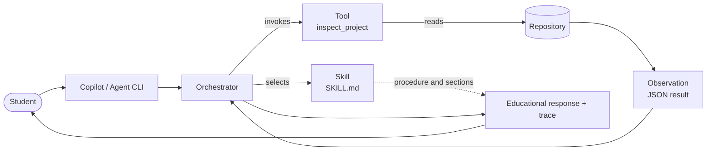

# Engineering Copilot Agent

> [Versión en español](README.es.md)

A small, friendly project that shows **how an AI agent works** from the inside.
Clone it, open it in VS Code and run it. No API keys, no cloud, no database:
just Python and the files in this repository.

> Models provide intelligence. Agents coordinate decisions and actions.
> Skills provide reusable procedures. Tools provide capabilities.

---

## 1. Project overview

The **Engineering Copilot Agent** helps students:

- inspect the structure of a project,
- read allowed files from the repository,
- explain code at beginner, intermediate or advanced level,
- run a basic code review (correctness, readability, tests, security),
- see exactly how a request becomes *skill selection -> tool call -> observation -> response*.

The agent is **deterministic**: instead of a large language model, it uses
small, readable rules. That way you can see every decision it makes. The same
architecture is used by real agents such as GitHub Copilot in agent mode; there
the decisions are made by a model.

## 2. Learning objectives

After this session you should be able to:

1. Explain what an agent is.
2. Tell the difference between a **model**, an **agent**, a **tool** and a **skill**.
3. Describe how an agent **observes** its environment through tools.
4. Explain how a tool lets an agent **act** safely.
5. Explain how a skill gives the agent a **reusable procedure**.
6. Extend the agent with a new skill and a new tool.
7. Use GitHub Copilot in VS Code to work with the project.

## 3. Architecture overview



The request lifecycle:

```text
User request
    -> Agent orchestrator
    -> Select skill
    -> Select and invoke tool
    -> Observe structured result
    -> Apply skill procedure
    -> Produce educational response
```

More detail: [docs/architecture.md](docs/architecture.md) and
[docs/diagrams.md](docs/diagrams.md).

## 4. Prerequisites

- Python **3.11 or newer** (`python --version`).
- Git.
- VS Code (recommended) with the Python extension and GitHub Copilot.

## 5. Quick start

```bash
git clone <repository-url>
cd engineering-copilot-agent
python -m venv .venv
```

Replace `<repository-url>` with the real URL of this repository.

Activate the virtual environment:

- Windows PowerShell:

  ```powershell
  .venv\Scripts\Activate.ps1
  ```

- Linux/macOS:

  ```bash
  source .venv/bin/activate
  ```

## 6. Installation commands

```bash
pip install -e ".[dev]"
pytest
ruff check .
```

`-e` installs the project in *editable* mode, so your changes take effect
immediately and the `engineering-agent` command can find the `skills/` folder.

## 7. Demo commands

Run these from the repository root:

```bash
engineering-agent inspect sample_project
engineering-agent explain sample_project/calculator.py --level beginner
engineering-agent review sample_project/calculator.py
engineering-agent skills
engineering-agent tools
```

More options:

```bash
engineering-agent info sample_project/calculator.py
engineering-agent explain sample_project/calculator.py --level advanced
engineering-agent review sample_project
engineering-agent ask "find potential issues in sample_project/calculator.py"
engineering-agent review sample_project/calculator.py --json
```

Without installing the command you can also use `python -m agent.cli <command>`.

Exit codes: `0` success, `1` controlled failure (invalid path, unknown request),
`2` usage error (invalid arguments).

## 8. Repository structure

```text
engineering-copilot-agent/
|-- .github/
|   |-- copilot-instructions.md     # How Copilot should behave in this repo
|   |-- instructions/               # File-type specific instructions
|   `-- prompts/                    # Reusable Copilot prompt files
|-- agent/
|   |-- instructions.md             # The agent's operating rules
|   |-- models.py                   # Data contracts (ToolSpec, Skill, AgentResponse...)
|   |-- tool_registry.py            # Register, list and invoke tools
|   |-- skill_loader.py             # Discover and parse SKILL.md files
|   |-- orchestrator.py             # The agent loop and intent rules
|   |-- code_analysis.py            # ast-based facts and review checks
|   |-- responses.py                # Turn observations into Markdown answers
|   `-- cli.py                      # Command-line interface
|-- tools/
|   `-- inspect_project.py          # Read-only tool: tree, read_file, file_info
|-- skills/
|   |-- explain-code/SKILL.md       # Procedure for explaining code
|   `-- code-review/SKILL.md        # Procedure for reviewing code
|-- sample_project/                 # A small calculator to explore
|-- tests/                          # pytest suite
|-- examples/                       # Step-by-step walkthroughs
`-- docs/                           # Architecture, diagrams, demo script, lab
```

## 9. Agents, tools and skills

| Concept | What it is | In this repository |
|---|---|---|
| **Model** | Provides intelligence: understands language and generates answers. | Replaced by transparent rules so you can see every decision. In Copilot, this is the LLM. |
| **Agent** | Coordinates decisions and actions in a loop: decide, act, observe, respond. | `agent/orchestrator.py` |
| **Tool** | A *capability*: code that does something in the environment and returns structured data. | `tools/inspect_project.py` (`tree`, `read_file`, `file_info`) |
| **Skill** | A *procedure*: Markdown instructions that say how to approach a task and shape the answer. It does not run anything by itself. | `skills/explain-code/SKILL.md`, `skills/code-review/SKILL.md` |
| **Environment** | What the agent observes. | This repository |

A useful way to remember it: a **tool** is a *hand* (it can touch things), a
**skill** is a *recipe* (it says what to do and in which order), and the
**agent** is the *cook* who decides which recipe to follow and which hand to use.

## 10. Example interaction

```text
$ engineering-agent explain sample_project/calculator.py --level beginner
Engineering Copilot Agent
=========================
Request        : explain sample_project/calculator.py
Selected skill : explain-code
Selected tool  : inspect_project.read_file
Tool arguments : {"operation": "read_file", "path": "sample_project/calculator.py"}
Why            : The request asks for an explanation, so the explain-code skill was selected. ...

Trace
-----
 1. Received request.
 2. Classified intent as code explanation.
 3. Selected explain-code skill.
 4. Loaded instructions from skills/explain-code/SKILL.md.
 5. Selected inspect_project.read_file.
 6. Validated requested path.
 7. Read file successfully.
 8. Parsed the source with ast (the code was not executed).
 9. Applied the explain-code response structure (7 sections, beginner level).
10. Produced educational response.

Response
--------
# Explanation of `sample_project/calculator.py`
## Purpose
...
```

Add `--json` to see the full structured response (`request`, `selected_skill`,
`selected_tool`, `tool_arguments`, `observation`, `reasoning_summary`,
`educational_response`, `trace`).

## 11. Safety boundaries

- The tool is **read-only**. It never writes, moves or deletes files.
- Paths must stay **inside the workspace root**. `../` tricks and absolute
  paths outside the root are rejected.
- Sensitive files (`.env`, private keys, credentials) are **never read**.
- Inspected code is **never executed**. Python is parsed with `ast`.
- No shell commands, no network, no API keys.

Try it:

```bash
engineering-agent explain ../README.md      # PATH_OUTSIDE_ROOT
engineering-agent explain .env              # SENSITIVE_FILE (if the file exists) or NOT_FOUND
```

See [SECURITY.md](SECURITY.md).

## 12. How to create a new skill

1. Create `skills/<your-skill>/SKILL.md` (lowercase letters, digits and hyphens).
2. Start it with front matter:

   ```markdown
   ---
   name: your-skill
   description: One sentence that says when to use this skill.
   ---
   ```

3. Write the **procedure** as numbered steps and the **rules** to follow.
4. Add a `## Response Sections` list with the sections of the answer.
5. Run `engineering-agent skills` to see it, and `pytest` to validate.
6. To make the CLI use it, add an `IntentRule` in `agent/orchestrator.py`.

Full walkthrough: [examples/04-build-your-own-skill.md](examples/04-build-your-own-skill.md).

## 13. How to create a new tool

A tool is a `ToolSpec`: a name, a description, its parameters and a handler
that returns a JSON-serializable dictionary.

```python
# tools/word_count.py
"""Count the words in a text file inside the workspace."""

from __future__ import annotations

from collections.abc import Mapping
from pathlib import Path
from typing import Any

from agent.models import JsonDict, ToolParameter, ToolSpec
from tools.inspect_project import read_file


def create_word_count_tool(root: Path) -> ToolSpec:
    """Build the word_count tool bound to ``root``."""

    def handler(arguments: Mapping[str, Any]) -> JsonDict:
        data = read_file(root, arguments)  # reuses every safety check
        return {"path": data["path"], "words": len(data["content"].split())}

    return ToolSpec(
        name="word_count",
        description="Count the words in a text file.",
        parameters=(ToolParameter("path", "File to analyze.", required=True),),
        handler=handler,
    )
```

Then register it in `build_default_registry` in `agent/tool_registry.py`:

```python
registry.register(create_word_count_tool(root))
```

Run `engineering-agent tools` to see it, and add a test in `tests/`.

## 14. Student challenges

1. Make the agent recognize the request `"summarize sample_project/README.md"`.
2. Create a `test-generator` skill that proposes pytest tests for a file.
3. Create a `word_count` tool and register it.
4. Add a review check that flags functions longer than 30 lines.
5. Review the calculator, decide which findings are real defects, and fix them
   with tests (in a separate branch).

The full lab with acceptance criteria is in [docs/student-lab.md](docs/student-lab.md).

## 15. Troubleshooting

| Problem | Solution |
|---|---|
| `engineering-agent: command not found` | Activate the virtual environment and run `pip install -e ".[dev]"`. Or use `python -m agent.cli`. |
| PowerShell says scripts are disabled | Run `Set-ExecutionPolicy -Scope CurrentUser RemoteSigned`, or use `.venv\Scripts\activate.bat` in `cmd`. |
| `NOT_FOUND` errors | Paths are relative to the current folder. Run commands from the repository root, or pass `--root`. |
| `Skills directory not found` | Install in editable mode (`-e`) or pass `--skills-dir path/to/skills`. |
| `python` is Python 2 or too old | Use `python3` or `py -3.11`. |
| Tests import errors | Run `pytest` from the repository root. |

## 16. License

[MIT](LICENSE). See also [CONTRIBUTING.md](CONTRIBUTING.md) and
[SECURITY.md](SECURITY.md).
