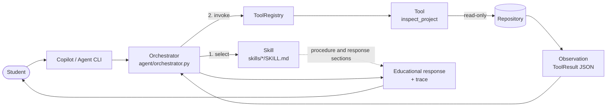
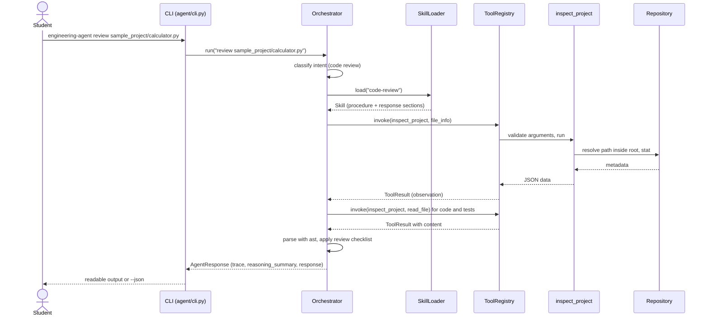
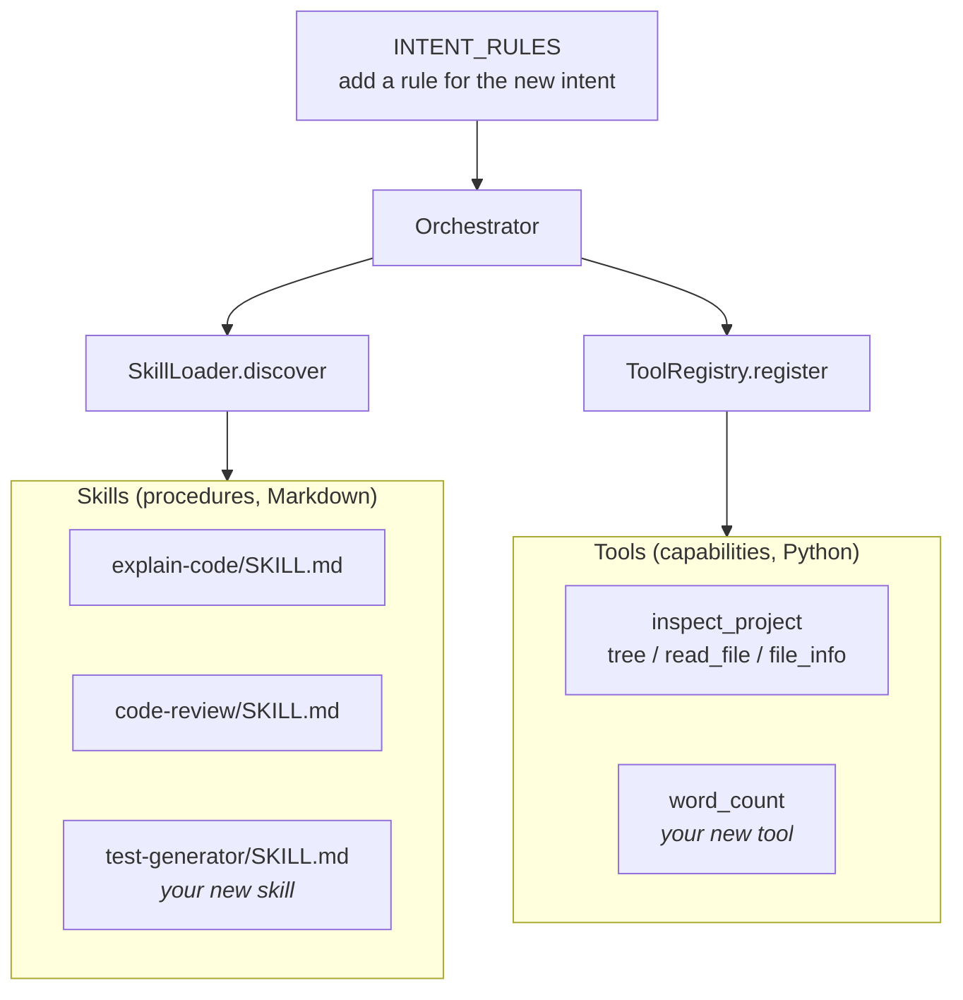
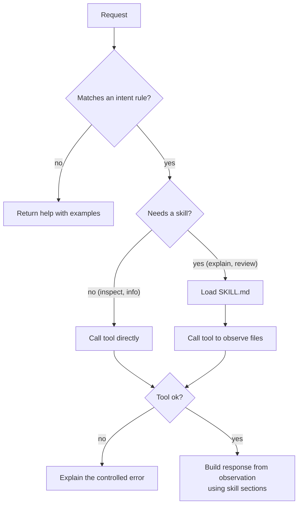

# Diagrams

All diagrams use Mermaid, which renders on GitHub and in VS Code's Markdown
preview (built-in Mermaid support or a Mermaid extension).

## 1. Architecture

## 2. Request lifecycle

## 3. Extending with skills and tools

Adding a **skill** = add a folder with `SKILL.md` (+ optionally an intent rule).
Adding a **tool** = write a `ToolSpec` factory and register it.

## 4. Decision flow inside the orchestrator

